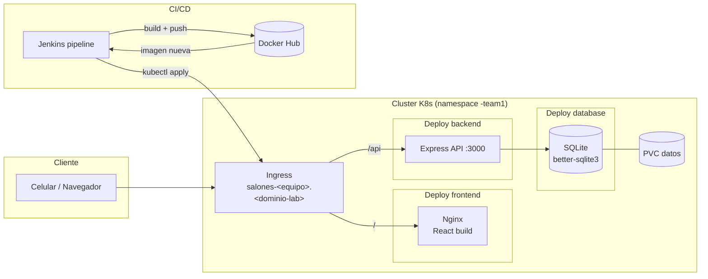
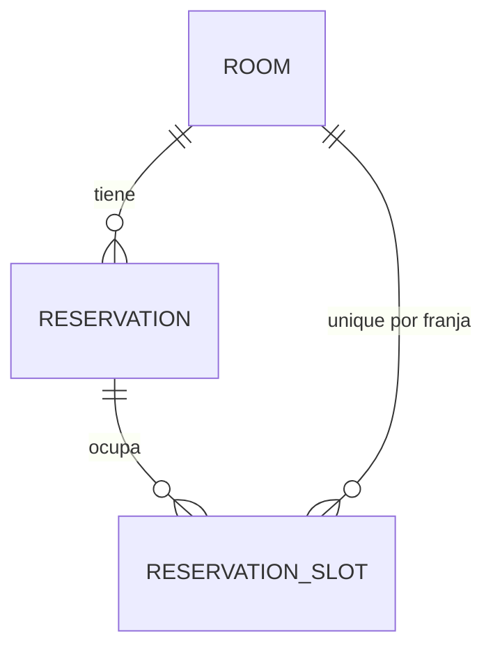
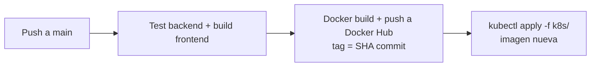

# Arquitectura — Reserva de Salones (Proyecto 2)

> Documento de arquitectura (v1 — escrito antes de programar). Se actualizará al final con lo realmente construido.

## 1. Descripción

Aplicación web usable desde el celular para consultar qué salones están libres y reservarlos a nombre de un alumno o de un grupo. Corre en el cluster de Kubernetes del laboratorio bajo el namespace del equipo, con URL propia, y se despliega vía pipeline de Jenkins.

## 2. Diagrama

## 3. Componentes

| Componente | Tecnología | Puerto | Imagen |
|---|---|---|---|
| Frontend | React + Vite (build servido por Nginx) | 80 | `<usuario>/salones-frontend` |
| Backend | Node.js + Express + better-sqlite3 | 3000 | `<usuario>/salones-backend` |
| Base de datos | SQLite (archivo en PVC) | — | (parte de la imagen backend) |

- **Rutas**: Ingress envía `/` al frontend y `/api/*` al backend.
- **Persistencia**: el archivo `data/app.db` vive en un PVC `ReadWriteOnce`. Si el pod se reinicia, los datos siguen ahí.
- **Réplicas**: 1 por componente (SQLite no admite múltiples escritores); los reinicios se cubren con probes y `strategy: Recreate`.

## 4. Datos y reglas de negocio

- Franjas horarias de 60 min, 08:00–22:00.
- `reservation_slots(room_id, date, slot)` con **UNIQUE** → garantiza que dos reservas simultáneas nunca solapen: la segunda recibe `409 Conflict`.
- Cancelación = `status='cancelled'` y borrado de sus slots (libera la franja).

## 5. Seguridad / roles

- **Login por selector de rol**: `alumno` (ingresa su nombre) o `admin` (clave simple por variable de entorno `ADMIN_PASSWORD`).
- El backend emite un token JWT firmado (`JWT_SECRET`); middleware `auth` + `requireRole('admin')`.
- Alumno: busca, reserva, ve y cancela las suyas. Admin: carga salones, ve/cancela cualquier reserva, ve stats agregados.

## 6. Pipeline Jenkins

- Sin tocar `kubectl` a mano: la pipeline actualiza el tag de la imagen de los Deployments.
- Credenciales en Jenkins: `dockerhub-credentials`, `kubeconfig-ucu`.

## 7. Decisiones y alternativas

- **SQLite sobre Postgres**: requisito del laboratorio; suficiente para el tráfico del curso. El archivo en PVC cumple la condición de persistencia.
- **Slots en tabla separada en vez de rangos**: los rangos con `CHECK` no pueden prevenir solapes en SQLite; una fila por franja con UNIQUE sí, de forma atómica.
- **Token simple en vez de usuarios con password**: requisito de acceso simple; la clave solo la usa el rol admin.

## 8. Pendientes / conocido

- Valores de `<equipo>`, `<dominio-lab>` y usuario de Docker Hub se centralizan en `k8s/config.env` y en el `Jenkinsfile`.
- Jenkins aún no existe en el laboratorio: se deja el `Jenkinsfile` y los requisitos documentados en el README.

---

# Estado final (v2 — actualizado tras construir)

## Lo que se construyó realmente

- **Backend** (Express + better-sqlite3): implementado tal como arriba. Los endpoints y las reglas son los descritos; la regla de no solapamiento quedó respaldada por `UNIQUE(room_id, date, slot)` insertado en transacción (devuelve 409). **10 tests pasan**, incluidos dos de concurrencia (peticiones simultáneas) y de solape.
- **Frontend** (React + Vite): las **6 vistas** planificadas están implementadas (Login, Disponibilidad, Salones, Calendario semanal, Mis reservas, Administración). El calendario resuelve la disponibilidad por celda con consultas a `/api/availability`. `npm run build` y `npm run lint` OK.
- **k8s**: `00-namespace`, `01-secret`, `02-pvc`, `03-backend`, `04-frontend`, `05-ingress`. Backend con `strategy: Recreate` y PVC `salones-data` en `/app/data`.
- **Docker**: `backend/Dockerfile` (multi-stage), `frontend/Dockerfile` (Vite build → Nginx con `BACKEND_URL` por envsubst), `docker-compose.yml` para local.

## Diferencias respecto a la v1

- El frontend no hace proxy de `/api` en el build de Vite (usa `VITE_API_BASE=/api`); en k8s el Ingress enruta `/api` al backend y en local lo hace Nginx con `BACKEND_URL`. En desarrollo Vite proxea a `localhost:3000`.
- Auth por **JWT** (`jsonwebtoken`) con middleware `auth` / `requireRole('admin')`. Login por selector de rol (alumno: nombre; admin: `ADMIN_PASSWORD`).
- Se agregaron endpoints de salud (`/api/health`) usados por las probes.
- Se implementaron también los **extras**: calendario semanal (obligatorio pedido) y estadísticas de administración. No se implementaron reservas repetidas ni límite por persona (quedan como trabajo futuro).

## Verificación

- `cd backend && npm test` → 10/10 OK.
- `cd frontend && npm run build && npm run lint` → OK (solo warnings informativos de react-hooks).
- Levantar backend y `GET /api/rooms` → 6 salones sembrados.

